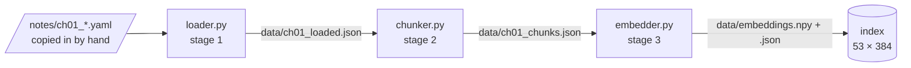
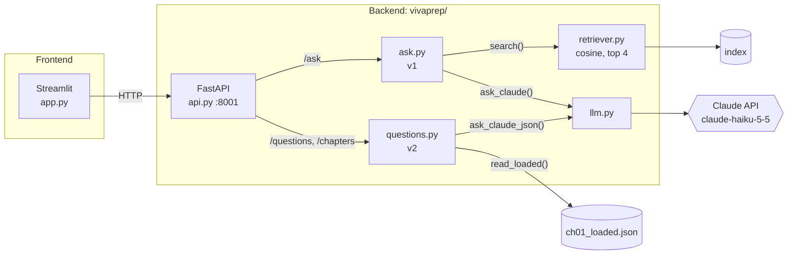
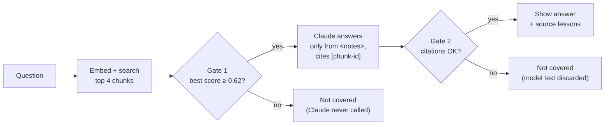
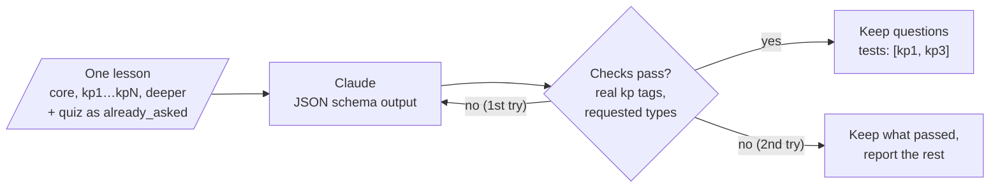

# VivaPrep architecture

An interview coach that answers and asks questions using only your own notes. It has two halves:

1. **Build time:** an offline pipeline turns the notes into a searchable index.
2. **Request time:** Ask mode (v1) and Question mode (v2) use that index and the lessons to call Claude.

Current scope: ch01 (7 lessons, 53 chunks). The design and roadmap are in `PLAN.md`.

## 1. Build time: the notes pipeline

Each stage is a module run with `python -m`. Each one writes a file in `data/`, and the next stage reads it. After you edit a note, rerun the stages in order.



```bash
python -m vivaprep.loader     # → data/<id>_loaded.json
python -m vivaprep.chunker    # → data/<id>_chunks.json
python -m vivaprep.embedder   # → data/embeddings.npy + data/embeddings.json
```

- **Load:** finds chapters by their own file header (`id`, `number`, `title`), not by a syllabus. It skips `kind:` entries and `status: coming`, and stops if a file is broken.
- **Chunk:** chunks follow the note structure, not a fixed size. Each lesson becomes `core`, `kp1…kpN`, `deeper` and `ownwords`, with stable ids like `ch01.l02.kp3` that citations point to. Quiz questions are never chunked. They are the labelled test set for `eval_retrieval.py`.
- **Embed:** uses `BAAI/bge-small-en-v1.5` through `fastembed`, on the local CPU. The text embedded is the lesson title plus the chunk text, and questions get bge's search prefix. The index records which model made it and refuses to load under a different model. The retriever also refuses if the chunks changed since they were embedded.

## 2. Request time: who talks to whom



- `llm.py` is the only file that calls Claude. It turns API errors into clear `SystemExit` messages, and `api.py` turns those into HTTP 503.
- `app.py` only speaks HTTP and never imports `vivaprep`, so the frontend can deploy to Streamlit Cloud without the embedding model or the API key.
- The command line (`python -m vivaprep.ask`, `python -m vivaprep.questions`) calls the same functions directly and skips the HTTP hop.

```bash
uvicorn vivaprep.api:app --port 8001   # backend
streamlit run app.py                   # frontend (VIVAPREP_API_URL, default http://127.0.0.1:8001)
```

## 3. Ask mode (v1): two gates before an answer is shown



- **Gate 1** runs in code and costs nothing: off-topic questions never reach the paid API. The 0.62 threshold was tuned by hand between the lowest in-notes score (0.638) and the highest off-notes score (0.602). Re-tune it if the embedding model or the chunking changes.
- **Gate 2** shows the answer only when the reply has no `NOT_COVERED` sentinel, cites at least one chunk, and cites only chunks that were sent.
- Refusals always show the fixed text `Not covered in the Notes`, never the model's own wording. Citations are removed before display, and draft lessons are tagged `⚠ draft note`.

## 4. Question mode (v2): scope is the guardrail



- No retrieval here, because the lesson is already known. Claude sees one whole lesson, so it can't ask about anything outside it.
- Structured output fixes the shape of the reply. Code checks the content: every key-point tag must exist in the lesson, and each requested type must appear exactly once.
- A chapter quiz asks one question per lesson. The type rotates (definition → why → scenario) from a random starting point, and all lessons run in parallel.
- The `tests` tags record which key points a full answer needs. v3 will grade against them.

## Module map

| Module | Role | Reads | Produces |
|---|---|---|---|
| `config.py` | Paths, model names, `TOP_K=4`, `SIMILARITY_THRESHOLD=0.62`; loads `.env` | `.env` | constants |
| `loader.py` | Stage 1: YAML → Chapter/Lesson; `read_loaded()` | `notes/*.yaml` | `data/<id>_loaded.json` |
| `chunker.py` | Stage 2: structure-based chunks; `chunk_lesson()` is reused by v2 | loaded JSON | `data/<id>_chunks.json` |
| `embedder.py` | Stage 3: fastembed bge-small; `embed_query()` | chunks JSON | `data/embeddings.npy` + `.json` |
| `retriever.py` | `search(q, k)`, `is_in_notes()` | index + chunks | hits with scores |
| `eval_retrieval.py` | Free, deterministic retrieval eval | quiz + off-notes questions | hit rate, refusals |
| `llm.py` | The only Claude caller | `ANTHROPIC_API_KEY` | text or JSON |
| `ask.py` | v1: RAG answer with two gates | retriever, llm | `Answer` |
| `questions.py` | v2: interview questions per lesson | loaded JSON, llm | `Quiz` |
| `api.py` | FastAPI: `/health`, `/ask`, `/chapters`, `/questions` | ask, questions | JSON |
| `app.py` | Streamlit UI with Chrome voice input | API over HTTP | web page |

## Swap points and what comes next

- **`search(query, k)`** is the one function a vector DB will replace: numpy now, then Chroma (local folder), optionally Chroma in Docker, Pinecone only at scale.
- **`llm.py`** holds the model, settings and error handling in one place.
- **v3 Feedback** will grade an answer against the key points in its question's `tests` list (LLM as judge), with the answer wrapped as data to resist prompt injection. **v3.5** tests the judge on about 10 hand-graded answers.
- **Not built yet:** `vivaprep/cli.py` (already declared in `pyproject.toml`), tests, and the fixed-size chunking comparison in `experiments/`.
